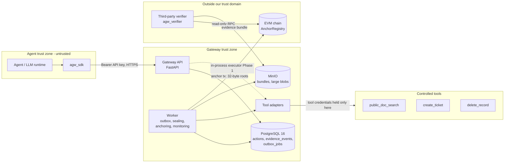
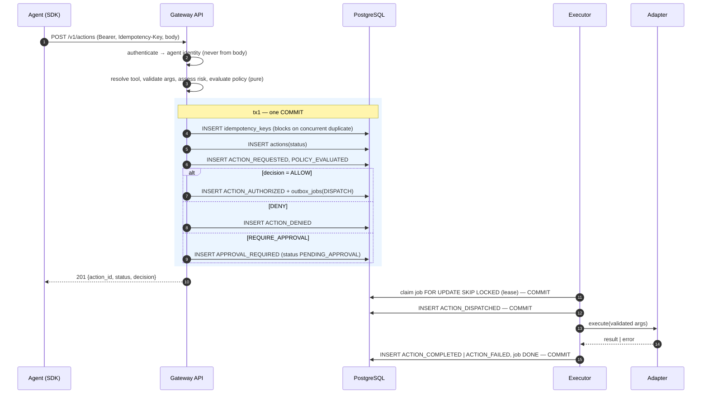

# 02 — Architecture

Status: Accepted (Phase 0). ADRs: 0001, 0002, 0003, 0004, 0008, 0009, 0017, 0018.

## 1. System context

**Trust boundaries**

| Boundary | Crossed by | Control |
|---|---|---|
| Agent → Gateway | HTTP request | API-key authentication. Identity comes from the credential only. Request schema validated. Deny by default. |
| Gateway → Tool | Adapter call | Only registered adapters. Only after a committed `ACTION_AUTHORIZED` + outbox job. Tool credentials are never given to agents. |
| Gateway → Chain | Anchor transaction | Only 32-byte roots + tenant key + epoch number. A dedicated signer key per deployment. The contract restricts submitters. |
| Verifier ↔ everything | Bundle + RPC | The verifier trusts **only** the chain and the math. It never calls the gateway. |

## 2. Components

| Component | Package | Responsibility | Phase |
|---|---|---|---|
| API layer | `agw_gateway.api` | Routing, request-id, uniform error model, no raw args in errors/logs | 1 |
| Auth | `agw_gateway.auth` | Bearer key → `AuthenticatedAgent{tenant_id, agent_id, scopes}` | 1 |
| Tool registry | `agw_gateway.tools` | Tool metadata, Pydantic arg models, adapter classes. Unknown → DENY. | 1 |
| Risk classifier | `agw_gateway.risk` | Pure function → `RiskAssessment{level, score, factors, mandatory_rule_ids}` | 1 (v1), 3+ |
| Policy engine | `agw_gateway.policies` | Pure function → `Decision{ALLOW\|DENY\|REQUIRE_APPROVAL, policy_id, policy_version, matched_rule_ids, reasons}` | 1 |
| Approvals | `agw_gateway.approvals` | Bound, expiring, single-use approvals | 4 |
| Action service | `agw_gateway.execution` | tx1 (request + decision + authorization + outbox). Idempotency. | 1 |
| Executor | `agw_gateway.execution` / `agw_worker.outbox` | Claims outbox jobs (`FOR UPDATE SKIP LOCKED`), writes DISPATCHED, calls adapter, writes result | 1 (in-process), 2+ (worker) |
| Reconciler | `agw_worker.outbox` | Lease-expired DISPATCHED → OUTCOME_UNKNOWN or adapter probe | 1 |
| Evidence writer | `agw_gateway.evidence` | Appends lifecycle events. Allocates per-tenant `seq` under a chain-head lock. (Phase 2+) canonical CBOR + event hash. | 1, 2 |
| Sealer | `agw_worker.sealing` | Builds RFC 9162 trees over contiguous seq ranges and computes `R_t` | 3 |
| Payload vault | `agw_gateway.crypto` | AES-256-GCM per-event DEK, KEK wrap, salted payload digest | 5 |
| Anchorer | `agw_worker.anchoring` | Submits roots, tracks submitted/included/finalized, handles reorgs, gates CRITICAL dispatch | 6 |
| Verifier | `agw_verifier` | Standalone CLI over evidence bundles + chain RPC | 7 |
| Monitor | `agw_worker.monitoring` | Periodic self-verification. Reports go to the monitoring stream. | 8 |
| Dashboard | `apps/dashboard` | Read-only investigation UI | 9 |

## 3. Action request flow (enforcement path)

Invariants (all tested in Phase 1):

1. No adapter call happens unless `ACTION_AUTHORIZED` and its outbox row are **committed**
   (ADR-0004).
2. No adapter call happens unless `ACTION_DISPATCHED` is committed. So every side effect is
   preceded by a durable record that it *might* have happened.
3. The outbox row, not in-memory state, is the source of truth for dispatch.
4. Policy and risk functions do no I/O and contain no LLM (ADR-0002).

For HIGH risk, the events of tx1 trigger an immediate seal (09 §4). For CRITICAL risk, the
outbox job is created in state `WAITING_ANCHOR`, and the executor can't claim it until the
anchor reaches the configured finality (ADR-0009, Phase 6).

## 4. Evidence pipeline

Paper A §3 pipeline (Capture → Canonicalize → Hash → Anchor → Certify → Verify) as realised here:

| Paper A stage | Our realisation | Durable state reached | Phase |
|---|---|---|---|
| Capture | Lifecycle event row inserted in the same tx as the state change it records | **captured** → **durably stored** at COMMIT | 1 |
| Canonicalize | Deterministic CBOR (AGW-CBOR-v1 profile) of the event record, stored as `canonical_bytes` | — | 2 |
| Hash | `event_hash = SHA256(TAG("AGW/event/v1") ‖ canonical_bytes)`, chained via `prev_event_hash` | **chained** | 2 |
| (batch) | RFC 9162 Merkle tree over a contiguous seq range, `R_t` chaining | **sealed** | 3 |
| Anchor | `AnchorRegistry.anchor(tenantKey, epochNo, R_t, R_{t-1})` | **submitted** → **included** → **finalized** | 6 |
| Certify | Evidence bundle: records + proofs + epoch headers + anchor refs (+ disclosed DEKs) | **exported** | 7 |
| Verify | `agw-verify bundle.agwb --rpc …` → VERIFIED / TAMPERED / INCOMPLETE per check | **verified** | 7 |

See [15-glossary.md](15-glossary.md) for the exact meaning of each state.

## 5. Security domains and chains

- A **tenant** is a security domain. Each tenant has exactly **one** hash chain and one epoch
  sequence (ADR-0008).
- All events of a tenant, of every risk level and evidence class, go into that chain in `seq`
  order. Risk only changes *when* an epoch is sealed and how urgently it is anchored.
- The monitoring stream (Paper A §5) is a separate system tenant, `_monitor`, with its own chain
  (ADR-0019).
- A single gateway deployment can host several tenants. The chain-head lock is per tenant, so
  tenants don't serialize against each other.

## 6. Deployment (local dev)

`docker-compose.yml` services by phase: `postgres:16` (1), `minio` (5), `anvil` from Foundry
(6), and `gateway` + `worker` images (1/2). Postgres init SQL in `infra/docker/postgres/`
creates two roles (08 §2): `agw_migrator` (schema owner) and `agw_app` (runtime, least
privilege). Tools run only in the gateway zone. In the demo they write only to a sandbox dir
and a `demo` schema.

## 7. What this architecture does not provide

- It can't see actions that never pass through the gateway (side channels, Paper B §VIII-A(4)).
  The control is *not* giving agents tool credentials or network routes.
- It can't make entries written after a full gateway compromise trustworthy (Paper B §II-C).
- Anchoring is not the authorization. Enforcement is decided entirely before and independently
  of anchoring. The CRITICAL gate only *adds* a precondition (09 §5).
