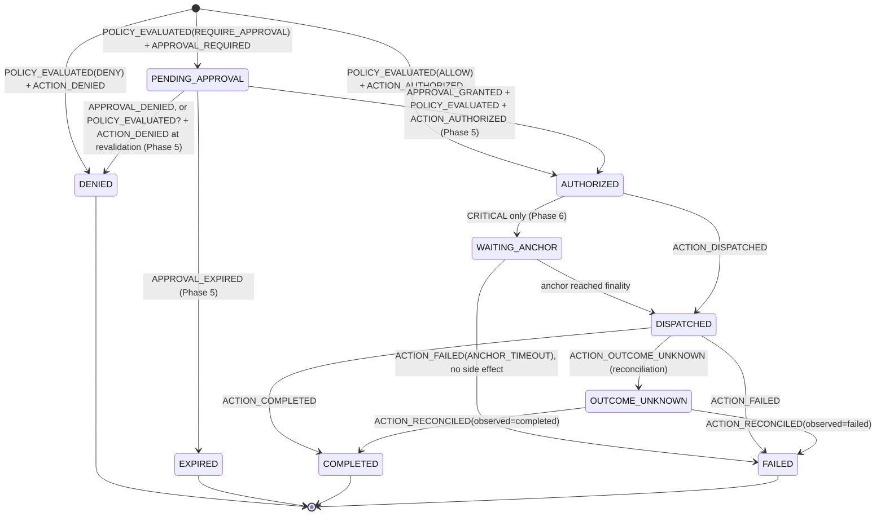

# 05 — Event Schema and Lifecycle

Status: Accepted (Phase 0). ADRs: 0003 (immutable events vs mutable actions), 0005 (CBOR
profile), 0013 (salted payloads). Sources: Paper B §III-B (eight fields), §III-C (record vs
payload); Paper A §3 (minimal event object, interaction classes), §4 (sequence numbers).

## 1. Two kinds of state

| | `actions` (operational) | `evidence_events` (evidence) |
|---|---|---|
| Mutability | Mutable `status`, `updated_at`, `version` (optimistic lock) | **Append-only.** No UPDATE/DELETE/TRUNCATE (DB grants + triggers) |
| Purpose | Fast current-state lookup, job coordination | What was proposed, decided, dispatched, observed |
| Source of truth for audit | No | **Yes**. `actions.status` MUST be derivable from the event sequence. |
| Hashed | Never | From Phase 2: exact stored `canonical_bytes` |

If `actions.status` disagrees with the latest lifecycle event, the event wins, and the monitor
(Phase 8) reports the drift.

## 2. Action lifecycle state machine

`ACTION_REQUESTED` always precedes `POLICY_EVALUATED` in the same transaction (tx1).
Terminal states: DENIED, EXPIRED, COMPLETED, FAILED. OUTCOME_UNKNOWN is *not* terminal. It
waits for reconciliation, which may be manual.

**Ordering invariant (Phase 1 test)** for the ALLOW path, by `seq`:
`ACTION_REQUESTED < POLICY_EVALUATED < ACTION_AUTHORIZED < ACTION_DISPATCHED < (ACTION_COMPLETED | ACTION_FAILED)`.

## 3. Event types

| Type | Class | Phase | Written in | Record fields of note | Payload (encrypted from Phase 5) |
|---|---|---|---|---|---|
| `ACTION_REQUESTED` | A2S | 1 | tx1 | actor, action, run, tool, env | **intent**: args, optional agent-supplied summary; **context provenance**: sources; **delegation provenance** |
| `POLICY_EVALUATED` | SYS | 1 | tx1 | **policy evaluation**: id, ver, effect, rules, reasons, controls, engine ver; risk | — |
| `ACTION_DENIED` | SYS | 1 | tx1 | reasons | — |
| `APPROVAL_REQUIRED` | A2H | 1 | tx1 | binding digest (Phase 4), expires | approval prompt |
| `APPROVAL_GRANTED` / `APPROVAL_DENIED` / `APPROVAL_EXPIRED` | A2H | 4 | approval tx | **human approval**: approver id, binding digest, prompt digest | approver comment |
| `ACTION_AUTHORIZED` | SYS | 1 | tx1 / approval tx | args digest (Phase 2+), approval ref, **code provenance** (gateway build, adapter version, policy digest) | — |
| `ACTION_DISPATCHED` | A2S | 1 | dispatch tx | attempt, worker id, anchor ref for CRITICAL (epoch, tx, block) | **execution**: exact parameters as passed to the adapter |
| `ACTION_COMPLETED` | A2S | 1 | result tx | outcome | **effects**: result / state diff |
| `ACTION_FAILED` | A2S/SYS | 1 | result tx | error code (`TOOL_ERROR`, `TIMEOUT`, `ANCHOR_TIMEOUT`, …) | effects: sanitized error |
| `ACTION_OUTCOME_UNKNOWN` | SYS | 1 | reconciler tx | last known attempt, reason (`LEASE_EXPIRED_AFTER_DISPATCH`) | — |
| `ACTION_RECONCILED` | SYS/A2H | 4 | reconcile tx | observed outcome, resolver (adapter probe or human id) | evidence of probe |
| `SECURITY_VIOLATION` | SYS | 1 | own tx | kind (`AGENT_ID_MISMATCH`, …), authenticated agent | claimed agent id (no args) |
| `AGENT_MESSAGE` | A2A | 10 | own tx | sender, recipient, refs.parent | message body |
| `DELEGATION_ISSUED` | A2A | 10 | own tx | delegator, delegate, scope digest | delegation token |
| `DELEGATION_CREATED` (Phase 8, replaces DELEGATION_ISSUED, ADR-0030) | A2A | 8 | issue tx | `delegation {id, depth, th, from, to, sc, tl, mr, exp, mu, kid, par?, root?}`, `run`, `refs.parent` (parent delegation's event) | `{purpose}` |
| `DELEGATION_REVOKED` (Phase 8) | A2A | 8 | revoke tx | `delegation {id, depth, th}`, `refs.parent` | — |
| `MONITOR_REPORT` | SYS | 8 | `_monitor` tenant | checked range, result | full report |
| `PAYLOAD_ERASED` | SYS | 5 | erasure tx | erased event id, legal-basis code, requester | — |
| `PAYLOAD_DELETED` (Phase 7, replaces PAYLOAD_ERASED) | SYS | 7 | retention / erasure tx | `erasure {event, seq, reason RETENTION\|ERASURE_REQUEST, policy}` | — |
| `KEY_DISCLOSED` | SYS | 7 | export tx | disclosed event ids, recipient id, purpose code | — |
| `DISCLOSURE_GRANTED` (Phase 7, replaces KEY_DISCLOSED) | A2H | 7 | grant tx | `disclosure {grant, auditor, key, mode, scope, exp, n, ids}`; purpose + ids in payload | payload |
| `DISCLOSURE_ACCESSED` (Phase 7) | A2H | 7 | every export attempt | `disclosure {...}` + `outcome {COMPLETED\|DENIED, code}` | — |

All eight Paper B §III-B fields are covered: **intent** (REQUESTED payload), **policy evaluation**
(POLICY_EVALUATED record), **human approval** (APPROVAL_*), **execution** (DISPATCHED payload),
**effects** (COMPLETED/FAILED payload), **context provenance** (REQUESTED payload + `env`),
**code provenance** (AUTHORIZED record), **delegation provenance** (REQUESTED payload,
DELEGATION_ISSUED, `refs.parent`). As in Paper B, raw chain-of-thought is **never** captured.

## 4. Event record (AGW-EVT v1)

The record is a CBOR map under profile AGW-CBOR-v1 (§6). It holds no sensitive content.
Optional fields are **omitted** when absent and are never encoded as `null`.

| Key | CBOR type | Req. | Meaning |
|---|---|---|---|
| `v` | uint | yes | Schema version = 1 |
| `tenant` | tstr | yes | Tenant id (security domain), `^[a-z0-9][a-z0-9-]{0,62}$` |
| `seq` | uint | yes | Per-tenant sequence number, from 0, gap-free |
| `prev` | bstr(32) | yes (Phase 2+) | `event_hash` of `seq-1`. 32 zero bytes for `seq = 0`. |
| `id` | bstr(16) | yes | Event id, UUIDv7 bytes |
| `type` | tstr | yes | §3 |
| `ts` | uint | yes | Gateway wall-clock, µs since Unix epoch UTC. Informational, not an ordering source. |
| `class` | tstr | yes | `A2S` \| `A2A` \| `A2H` \| `SYS` |
| `actor` | map {`kind`: tstr, `id`: tstr} | yes | kind ∈ `agent`, `human`, `gateway`, `system`. id from the authenticated identity only. |
| `action` | bstr(16) | opt | Action id |
| `run` | bstr(16) | opt | Run id |
| `tool` | map {`id`: tstr, `ver`: tstr} | opt | |
| `env` | tstr | opt | `dev` \| `staging` \| `prod` |
| `risk` | map {`level`: tstr, `score`: uint, `rules`: [tstr], `cv`: tstr} + risk-v2 (ADR-0026): `pid`: tstr, `pver`: uint, `pd`: bstr(32) risk policy digest, `f`: [{`n`,`v`,`p`,`w`,`miss`?}], `reasons`: [tstr], `forced`?: tstr | opt | §04 §2.3, ADR-0026 |
| `policy` | map {`id`: tstr, `ver`: uint, `effect`: tstr, `rules`: [tstr], `reasons`: [tstr], `controls`: [tstr], `ev`: tstr} | opt | §04 §4.4 |
| `approval` | map {`id`: bstr(16), `binding`: bstr(32) action digest, `exp`: uint µs, `req`?: 1\|2, `votes`?: uint, `approver`?: tstr, `dec`?: `APPROVED`\|`REJECTED`, `dd`?: bstr(32), `sig`?: bstr(64), `kid`?: tstr, `decs`?: [{`approver`, `dd`, `sig`, `kid`}]} | opt | Phase 5, ADR-0027 §6 |
| `args` | bstr(32) | opt | `args_digest` (06 §3), Phase 2+ |
| `dispatch` | map {`attempt`: uint, `worker`: tstr, `anchor`: map} | opt | |
| `outcome` | map {`status`: tstr, `code`: tstr} | opt | |
| `payload` | map {`digest`: bstr(32), `len`: uint} | opt | Commitment to the plaintext payload (06 §5) |
| `refs` | map {`parent`: bstr(32), `causes`: [bstr(32)]} | opt | Hash references to earlier events (Paper A §4 declared dependency) |
| `code` | map {`gw`: tstr, `adapter`: tstr, `policy`: bstr(32)} | opt | Code provenance |
| `violation` | map {`kind`: tstr, `claimed`: tstr} | opt | SECURITY_VIOLATION only (Phase 8 adds kind `DELEGATION_REFUSED`) |
| `delegation` | map (ADR-0030 §3) | opt | Phase 8: DELEGATION_* events; on a delegated ACTION_REQUESTED `{id, depth, th, from, root, ev}` (gateway-verified chain) |

**Unknown keys** are rejected by the v1 encoder and by the verifier. New fields require
`v = 2` and a new ADR.

> Phase 5 note (ADR-0027): the `approval` map was redefined before any record used it
> (APPROVAL_* were model-only until Phase 5). APPROVAL_GRANTED / DENIED / EXPIRED are
> writable; `violation.kind` gains `AGENT_ON_HUMAN_ENDPOINT`; the APPROVAL_GRANTED/DENIED
> payload `approval` section is `{"record": <signed decision record>, "comment": tstr}`.
> The prompt's "APPROVAL_REQUESTED" is the existing APPROVAL_REQUIRED type.

> Phase 4 note (ADR-0026): optional keys were added *inside* the existing `risk` map,
> discriminated by `cv = "risk-v2"`, as ADR-0023 did for Phase 2 additions. "New fields" above
> means new top-level keys; Phase 1–3 records remain valid unchanged.

## 5. Payload (AGW-PAY v1)

Plaintext CBOR map, encrypted at rest from Phase 5 (07). The record commits to it through
`payload.digest`.

| Key | Type | Req. | Meaning |
|---|---|---|---|
| `v` | uint | yes | 1 |
| `salt` | bstr(32) | yes | Fresh CSPRNG bytes. Makes the digest hiding (ADR-0013). |
| `event` | bstr(16) | yes | Event id this payload belongs to (prevents re-attachment) |
| `intent` | map | opt | `{"args": <validated args>, "summary": tstr}` |
| `execution` | map | opt | `{"params": <exact adapter input>}` |
| `effects` | map | opt | `{"result": <any>, "error": tstr}` |
| `context` | map | opt | `{"sources": [{"uri": tstr, "digest": bstr(32)}]}` |
| `delegation` | map | opt | `{"from": tstr, "parent": bstr(32), "scope": [tstr]}` |
| `approval` | map | opt | `{"prompt": tstr, "comment": tstr}` |

Payloads over 1 MiB are stored as a separate blob (MinIO). The payload then holds
`{"blob": {"digest": bstr(32), "len": uint}}`.

## 6. CBOR profile AGW-CBOR-v1 (normative summary; bytes in 06)

Base: RFC 8949 §4.2.1 *Core Deterministic Encoding Requirements*. Additional restrictions:

1. Preferred serialization. Integers in shortest form. Definite lengths only.
2. Map keys: **text strings only**, unique, sorted by bytewise lexicographic order of their
   deterministic encodings (RFC 8949 §4.2.1). With text-only keys the CBOR length header is
   monotonic in key length, so this equals the "length-first" order of RFC 7049 §3.9. Phase 2
   still verifies the chosen library against vectors.
3. **No floating-point values** anywhere. Decimals are canonical decimal text (`"12.50"` →
   `"12.5"`; no exponent; no leading `+`; `-0` → `"0"`). Tool arg models MUST NOT declare
   `float`.
4. Integers in [−2^63, 2^64−1]. No bignum tags.
5. **No tags**. UUIDs and digests are `bstr`. Timestamps are `uint` µs.
6. Simple values: `false`, `true`. `null` only inside payload values, never in records.
   `undefined` is forbidden.
7. Text strings are valid UTF-8 and are hashed as given. **No Unicode normalization** is applied
   (the stored bytes are the truth).
8. Decoder strictness: an input is valid only if `encode(decode(x)) == x` byte-for-byte. The
   verifier MUST enforce this.
9. Limits: record ≤ 16 KiB, nesting depth ≤ 16, inline payload ≤ 1 MiB.

## 7. Phase 1 storage form (pre-CBOR)

> Phase 2 (implemented): headers are stored as canonical CBOR in `canonical_bytes` (NOT NULL) with
> `event_hash`; JSONB `body` is the derived projection. Header additions (`obs`, `dispatch.cg`,
> `payload.ref`, `code.agent`) are recorded in ADR-0023. Models: `packages/schemas/src/agw_schemas/events.py`.

Phase 1 stores `body JSONB` with **the same keys** as §4 (bstr as lowercase hex, UUIDs as
canonical strings, `prev` omitted) and `canonical_bytes BYTEA NULL`. Phase 2 makes
`canonical_bytes` NOT NULL for new rows. From then on JSONB is a *derived, non-authoritative*
projection decoded from `canonical_bytes`, and it is never hashed (ADR-0005).
Phase 1 rows can't be backfilled because they're immutable. See 14 §8 for the migration rule.
